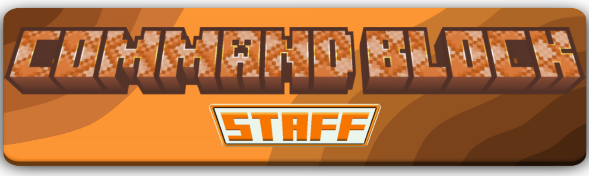

<figure markdown="span">
  { width="760" }
</figure>

Drop a command block into an **[AvM Staff Mod](https://modrinth.com/mod/avm-staff)** staff and you're holding
the thing from Animation vs Minecraft — six abilities, one item, no commands to memorise.

[Download :material-download:](https://modrinth.com/mod/command_block_staff_addon){ .md-button .md-button--primary }
[Issues :material-bug:](https://github.com/Pandzio21/command-block-staff/issues){ .md-button }

| # | Ability | |
|---|---------|--|
| 1 | **[Beam](abilities/beam.md)** | Grab things and throw them. |
| 2 | **[Electrify](abilities/electrify.md)** | Freeze mobs and players where they stand. |
| 3 | **[Placement](abilities/placement.md)** | Build, fill, carve, and move whole walls around. |
| 4 | **[Projectile](abilities/projectile.md)** | Rain arrows, or gather a swarm and send it all at once. |
| 5 | **[Shield](abilities/shield.md)** | A dome that stops basically everything. |
| 6 | **[Commands](abilities/commands.md)** | Effects, items, structures — point and click. |

Switch abilities with **Z + scroll**. Each one has modes on **Left Alt**, something to tune with
**`` ` `` + scroll**, and its own menu on **V**. You can also **[ride the staff](ride.md)**, write your own
commands and projectiles, and switch off anything you don't want on your server.

Closed source — this repo and site are just for bug reports and ideas.
