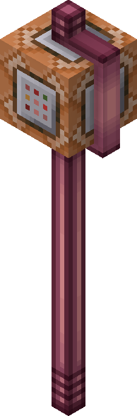

# Installation

An add-on — it needs the base **AvM Staff Mod**. Minecraft **1.21** or **1.21.1**, Java **21**.

Grab the jar for your loader: `commandblockstaff-<version>-fabric.jar` or `-neoforge.jar`.

=== "Fabric"

    | Required | Minimum |
    |---|---|
    | [AvM Staff Mod](https://modrinth.com/mod/avm-staff) | 1.0.0-beta.1 |
    | [Fabric API](https://modrinth.com/mod/fabric-api) | 0.102.0+1.21 |
    | [Fabric Language Kotlin](https://modrinth.com/mod/fabric-language-kotlin) | 1.11.0+kotlin.2.0.0 |
    | [Architectury API](https://modrinth.com/mod/architectury-api) | 13.0.8 |

=== "NeoForge"

    | Required | Minimum |
    |---|---|
    | [AvM Staff Mod](https://modrinth.com/mod/avm-staff) | 1.0.0-beta.1 |
    | [NeoForge](https://neoforged.net/) | 21.0.164 |
    | [Kotlin for Forge](https://modrinth.com/mod/kotlin-for-forge) | 5.4.0 |
    | [Architectury API](https://modrinth.com/mod/architectury-api) | 13.0.8 |

## Optional

- **[GeckoLib](https://modrinth.com/mod/geckolib)** 4.5.0+ — only the animated model for
  **[riding the staff](ride.md)**. The flight itself works without it; you just don't get the animation.
- **[Mod Menu](https://modrinth.com/mod/modmenu)** (Fabric) — the config button in the mod list.
- **[Cloth Config](https://modrinth.com/mod/cloth-config)** — a nicer config screen. Without it you get a
  built-in one that does the same job.

None of these are bundled — install them yourself if you want them.

!!! warning "GeckoLib on 1.21.1"

    GeckoLib's **1.21** build claims to support 1.21.1, but one of its own mixins finds no targets there
    and hard-crashes the game while loading resources. That's a GeckoLib bug, not this add-on's.

    On 1.21.1: either run without GeckoLib, or use a GeckoLib build made for 1.21.1. On 1.21 the normal
    build is fine. This is exactly why GeckoLib is optional here.

## Getting the staff

Put a **command block** into a Royal Staff or Scepter of Friendship (base mod's insert key, default
**R**) and hold it — you get the command-block staff:

<figure markdown="span">
  { width="150" }
</figure>

Press **Z + scroll** to pick an ability.
